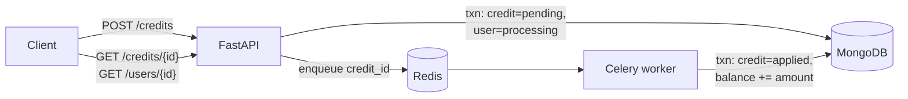

# Credit Service

An asynchronous service for crediting user balances. A FastAPI endpoint accepts the credit and returns `202 Accepted` right away. A Celery worker then applies it to the user's balance in MongoDB, with Redis as the message broker.



Design rationale, trade-offs and failure modes are in **[docs/design.md](docs/design.md)**.

## Quickstart

Prerequisites: Docker (with Compose v2). For running tests on the host, you also need [uv](https://docs.astral.sh/uv/).

```bash
cp .env.example .env     # optional: only needed to change ports or keys
make up                  # builds and starts api, worker, mongo, redis (waits until healthy)
make demo                # walks through the flow with curl
```

Interactive API docs: <http://localhost:8000/docs>. Use the **Authorize** button with the key `dev-local-key`.

### Try it by hand

```bash
KEY=dev-local-key

curl -s -X POST localhost:8000/credits \
  -H "X-API-Key: $KEY" -H "Content-Type: application/json" \
  -d '{"user_id": "u_123", "amount": "150.00"}'
# 202 {"task_id": "4f6c…", "status": "pending"}   + Location: /credits/4f6c…

curl -s localhost:8000/users/u_123 -H "X-API-Key: $KEY"
# {"user_id": "u_123", "balance": "150.00", "status": "processed", "pending_credits": 0}

curl -s localhost:8000/credits/<task_id> -H "X-API-Key: $KEY"
# {"task_id": "…", "user_id": "u_123", "amount": "150.00", "status": "applied", …}
```

`make down` stops the stack. `make clean` also deletes the data volumes.

## API

All `/credits` and `/users` routes require an `X-API-Key` header.

| Method | Path | Description |
|---|---|---|
| `POST` | `/credits` | Body `{"user_id": str, "amount": decimal}`. Returns **202** with `task_id` and a `Location` header. Accepts an optional `Idempotency-Key` header. |
| `GET` | `/credits/{task_id}` | Credit status: `pending` → `applied` or `failed`. |
| `GET` | `/users/{user_id}` | Balance, status (`processing` / `processed`) and number of pending credits. |
| `GET` | `/healthz` | Liveness check (no dependencies). |
| `GET` | `/readyz` | Readiness check: pings MongoDB and Redis, returns 503 if either is down. |

**Validation:** `amount` must be greater than 0 and at most 1,000,000, with at most 2 decimal places. Send it as a JSON number or a string. `user_id` may contain only `[A-Za-z0-9_-]`, up to 64 characters. Unknown fields are rejected.

**Money:** amounts are stored as `Decimal128` and returned as strings (`"150.00"`) so clients never see float rounding.

**Errors:** every error uses the same shape, `{"error": {"code", "message", "details"?}}`:

| Status | When |
|---|---|
| 401 | Missing or invalid `X-API-Key` |
| 404 | Unknown credit or user |
| 409 | `Idempotency-Key` reused with a different request body |
| 422 | Validation failed |
| 503 | MongoDB or the queue is unavailable. Safe to retry with the same `Idempotency-Key`. |

## Tests

```bash
make install     # uv sync
make test-unit   # validation rules, no services needed
make test        # starts mongo + redis, runs unit + integration tests
make test-e2e    # starts the full stack, runs end-to-end tests through the real queue
make lint        # ruff + mypy --strict
```

| Layer | What it proves |
|---|---|
| Unit (`tests/unit`) | Amount and user-ID validation; money formatting. |
| Integration (`tests/integration`) | Against a real MongoDB replica set: applying the same credit twice credits once (including 8 concurrent duplicate deliveries); 50 concurrent credits sum exactly; status stays `processing` until the last credit settles; failure paths release the user; idempotency keys; API status codes, auth and the error format. |
| End-to-end (`tests/e2e`) | API → Redis → worker → MongoDB. A task re-sent after it was applied doesn't change the balance. |

CI (`.github/workflows/ci.yml`) runs lint, type checks and all three layers on every push.

## Configuration

Settings come from environment variables. On the host, `.env` is also read.

| Variable | Default | Purpose |
|---|---|---|
| `CREDITS_MONGO_URL` | `mongodb://localhost:27017/?directConnection=true` | Must point at a replica set, which transactions require. |
| `CREDITS_MONGO_DB` | `credits` | Database name. |
| `CREDITS_REDIS_URL` | `redis://localhost:6379/0` | Celery broker. |
| `CREDITS_API_KEYS` | *(empty: all requests rejected)* | Comma-separated service keys. Compose sets `dev-local-key`. |
| `CREDITS_TASK_MAX_RETRIES` | `5` | Worker retries for transient MongoDB errors, with exponential backoff. |
| `CREDITS_LOG_LEVEL` | `INFO` | Log level for the JSON logs. |
| `MONGO_PORT` / `REDIS_PORT` / `API_PORT` | `27017` / `6379` / `8000` | Host ports Compose publishes. Change them if they clash with local services. |

## Project layout

```
app/
  config.py            settings (pydantic-settings)
  domain.py            request/response models, money validation
  db.py                Mongo clients and indexes
  repository.py        all persistence rules: transactions, idempotent apply
  publisher.py         enqueue abstraction (Celery implementation)
  logging.py           JSON logging (structlog)
  api/                 FastAPI app, routes, auth, error handlers, request-id middleware
  worker/              Celery app config and the apply_credit task
tests/{unit,integration,e2e}
scripts/demo.sh
docs/design.md
```

Routes and tasks stay thin. The business rules live in `repository.py`, so they can be tested without HTTP or a broker.
