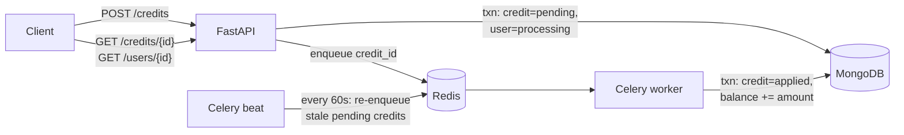

# Credit Service

An asynchronous service for crediting user balances. A FastAPI endpoint accepts the credit and returns `202 Accepted` right away. A Celery worker then applies it to the user's balance in MongoDB, with Redis as the message broker.



Design rationale, trade-offs and failure modes are in **[docs/design.md](docs/design.md)** ([PDF](docs/design.pdf), two pages).

## Quickstart

Prerequisites: Docker (with Compose v2). For running tests on the host, you also need [uv](https://docs.astral.sh/uv/). The service targets Python 3.12, which uv installs automatically.

```bash
cp .env.example .env     # optional: only needed to change ports or keys
make up                  # builds and starts api, worker, beat, mongo, redis (waits until healthy)
make demo                # walks through the flow with curl
```

Interactive API docs: <http://localhost:8000/docs>. Use the **Authorize** button with the key `dev-local-key`. The docs are on in the local Compose stack and off by default elsewhere (`CREDITS_DOCS_ENABLED`).

### Try it by hand

```bash
KEY=dev-local-key

curl -s -X POST localhost:8000/credits \
  -H "X-API-Key: $KEY" -H "Content-Type: application/json" \
  -d '{"user_id": "u_123", "amount": "150.00"}'
# 202 {"task_id": "4f6c…", "status": "pending"}   + Location: /credits/4f6c…

curl -s localhost:8000/users/u_123 -H "X-API-Key: $KEY"
# {"user_id": "u_123", "balance": "150.00", "status": "processed", "pending_credits": 0}

curl -s localhost:8000/credits/<task_id> -H "X-API-Key: $KEY"
# {"task_id": "…", "user_id": "u_123", "amount": "150.00", "status": "applied", …}
```

`make down` stops the stack. `make clean` also deletes the data volumes.

## API

All `/credits` and `/users` routes require an `X-API-Key` header.
- **Keys and clients:** each key belongs to a named client, for example `billing`. The client name is recorded on every credit, and both idempotency keys and rate limits are scoped to it.
- **Rate limit:** each client gets 600 requests per minute, counted in Redis so the limit holds across API instances. If Redis is unreachable, requests are allowed rather than rejected.

| Method | Path | Description |
|---|---|---|
| `POST` | `/credits` | Body `{"user_id": str, "amount": decimal}`. Returns **202** with `task_id` and a `Location` header. Accepts an optional `Idempotency-Key` header. |
| `GET` | `/credits/{task_id}` | Credit status: `pending` → `applied` or `failed`. Also `redeliveries`: how many duplicate deliveries the worker safely ignored. |
| `GET` | `/users/{user_id}` | Balance, status (`processing` / `processed`) and number of pending credits. |
| `GET` | `/healthz` | Liveness check (no dependencies). |
| `GET` | `/readyz` | Readiness check: pings MongoDB and Redis, returns 503 if either is down. |

**Validation:**
- `amount` must be greater than 0 and at most 1,000,000, with at most 2 decimal places.
- Send `amount` as a JSON number or a plain decimal string such as `"12.50"`. Spellings like `"1_000"`, `"1E+6"` or padded strings are rejected.
- `user_id` may contain only `[A-Za-z0-9_-]`, up to 64 characters.
- Unknown fields are rejected, and request bodies are limited to 16 KB.

**Idempotency:**
- Keys are scoped per client and user, and honoured for 24 hours. After that, an hourly job releases them; the credit stays in the ledger.
- Replaying a key with the same user and amount returns the original `task_id` and its current status, without enqueueing again.
- The same key with a different amount returns 409.
- If the original request got a 503, the key is freed, so retrying with it creates and enqueues the credit.

**Money:** amounts are stored as `Decimal128` and returned as strings (`"150.00"`) so clients never see float rounding.

**Errors:** every error uses the same shape, `{"error": {"code", "message", "details"?}}`:

| Status | When |
|---|---|
| 401 | Missing or invalid `X-API-Key` |
| 429 | Client is over its rate limit. `Retry-After` gives the seconds until the window resets. |
| 404 | Unknown credit or user |
| 409 | `Idempotency-Key` reused for the same user with a different amount |
| 411 / 413 | Request body has no `Content-Length`, or is larger than 16 KB |
| 422 | Validation failed |
| 500 | Unexpected error (details are logged, never returned) |
| 503 | MongoDB or the queue is unavailable. Safe to retry with the same `Idempotency-Key`. |

**Logs:** every line from the API, worker and beat is JSON on stdout. A request's `X-Request-ID` (or a generated one) is carried into the worker, so one ID ties together a credit's API and worker log lines.

**Failure handling:**
- **Transient MongoDB errors in the worker** (connection loss, timeouts) are retried with capped exponential backoff. If retries run out, the credit stays `pending` rather than being failed.
- **Stuck credits:** a Celery beat job re-enqueues any credit still `pending` after 2 minutes. This covers an API crash between saving and enqueueing, lost broker messages and killed workers. Re-enqueueing is safe because applying a credit is idempotent.
- **Other errors** mark the credit `failed`, with the stable code `processing_error`.

## Tests

```bash
make install     # uv sync
make test-unit   # validation rules, no services needed
make test        # starts mongo + redis, runs unit + integration tests
make test-e2e    # starts the full stack, runs end-to-end tests through the real queue
make lint        # ruff + mypy --strict
```

| Layer | What it proves |
|---|---|
| Unit (`tests/unit`) | Amount and user-ID validation; money formatting. |
| Integration (`tests/integration`) | Runs against a real MongoDB replica set. Applying the same credit twice credits once, including 8 concurrent duplicate deliveries. 50 concurrent credits sum exactly. Status stays `processing` until the last credit settles. Failure paths release the user. Also covers idempotency keys (including retry after 503), the worker's retry and failure policy, reconciliation, and the API's status codes, auth, size limits and error format. |
| End-to-end (`tests/e2e`) | API → Redis → worker → MongoDB. A task re-sent after it was applied is consumed (`redeliveries` = 1) and doesn't change the balance. |

CI (`.github/workflows/ci.yml`) runs lint, type checks and all three test layers on pushes to `main` and on pull requests. GitHub Actions and container images are pinned to exact digests, and Dependabot (`.github/dependabot.yml`) proposes weekly updates for them and for Python dependencies.

## Configuration

Settings come from environment variables. On the host, `.env` is also read.

| Variable | Default | Purpose |
|---|---|---|
| `CREDITS_MONGO_URL` | `mongodb://localhost:27017/?directConnection=true` | Must point at a replica set, which transactions require. |
| `CREDITS_MONGO_DB` | `credits` | Database name. |
| `CREDITS_REDIS_URL` | `redis://localhost:6379/0` | Celery broker. |
| `CREDITS_API_KEYS` | *(empty: all requests rejected)* | Comma-separated `client:key` pairs, e.g. `billing:k1,payouts:k2`. A bare `key` belongs to client `default`. Compose sets `local:dev-local-key`. |
| `CREDITS_RATE_LIMIT_PER_MINUTE` | `600` | Requests allowed per client per minute. |
| `CREDITS_IDEMPOTENCY_KEY_TTL_S` | `86400` | How long an `Idempotency-Key` is honoured. |
| `CREDITS_DOCS_ENABLED` | `false` | Serve `/docs`, `/redoc` and `/openapi.json`. Compose sets `true`. |
| `CREDITS_MONGO_TIMEOUT_MS` | `5000` | Upper bound for each MongoDB operation or transaction. |
| `CREDITS_TASK_MAX_RETRIES` | `10` | Worker retries for transient MongoDB errors. |
| `CREDITS_TASK_RETRY_BACKOFF_MAX_S` | `60` | Cap on the retry delay (exponential backoff with full jitter). |
| `CREDITS_RECONCILE_AFTER_S` | `120` | Age at which a still-pending credit is re-enqueued. |
| `CREDITS_RECONCILE_INTERVAL_S` | `60` | How often the reconciliation job runs. |
| `CREDITS_MAX_BODY_BYTES` | `16384` | Largest request body accepted. |
| `CREDITS_LOG_LEVEL` | `INFO` | Log level for the JSON logs. |
| `MONGO_PORT` / `REDIS_PORT` / `API_PORT` | `27017` / `6379` / `8000` | Host ports Compose publishes. Change them if they clash with local services. |

## Project layout

```
app/
  config.py            settings (pydantic-settings)
  domain.py            request/response models, money validation
  db.py                Mongo clients and indexes
  repository.py        all persistence rules: transactions, idempotent apply
  publisher.py         enqueue abstraction (Celery implementation)
  logging.py           JSON logging (structlog)
  api/                 FastAPI app, routes, auth, health probes, error handlers, middleware
  worker/              Celery config, apply_credit task, reconciliation job
tests/{unit,integration,e2e}
scripts/demo.sh
docs/design.md
```

Routes and tasks stay thin. The business rules live in `repository.py`, so they can be tested without HTTP or a broker.
