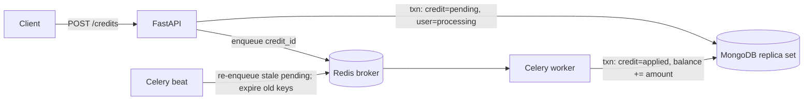

# Credit Service: Design

## 1. Problem and assumptions

A client calls `POST /credits` with a `user_id` and an `amount`. The API records the request, marks the user `processing` and returns `202 Accepted` with a task ID. A Celery worker then adds the amount to the user's `balance` and marks the user `processed`.

Because this moves money, the design aims to:

- never lose a credit the API accepted
- never apply a credit twice
- never report a user `processed` while one of their credits is still in flight

Assumptions:

- An unknown `user_id` is created on its first credit.
- Credits are positive, at most 1,000,000, with 2 decimal places, in one currency.
- Callers are trusted internal services that authenticate with API keys.

## 2. Architecture

| Component | Responsibility |
|---|---|
| **FastAPI** (`app/api`) | Authenticates and rate-limits the caller, validates input, records the pending credit and enqueues it. Also serves status polling (`GET /credits/{id}`, `GET /users/{id}`) and health checks. |
| **MongoDB** | The source of truth. The `credits` collection is a ledger with one document per request. The `users` collection holds `balance`, `status` and `pending_credits`. It runs as a single-node replica set because transactions require one. |
| **Redis** | The Celery broker, with append-only persistence so a restart loses at most about 1 second of queued tasks. It also holds the rate-limit counters. |
| **Celery worker / beat** | The worker applies credits, retrying transient failures. Beat re-enqueues stuck credits and expires old idempotency keys. |

**Code layout:** the business rules live in `app/repository.py`. The route and the Celery task are thin layers over it, so the important logic can be tested against a real database without HTTP or a broker.

## 3. Key decisions

| Decision | Choice | Rationale and trade-off |
|---|---|---|
| **Broker** | Redis | Fewest moving parts. Its weaker delivery guarantees are covered by the worker being idempotent (§4). I'd move to RabbitMQ if we needed routing, priorities or a native dead-letter queue. |
| **Delivery** | At-least-once: `acks_late`, `reject_on_worker_lost`, prefetch 1 | A crashed worker's task is redelivered rather than lost. The cost is duplicate deliveries, which the worker ignores safely. |
| **Status store** | MongoDB only; no Celery result backend | One source of truth. The Celery task ID *is* the credit ID, so there's one ID to poll, log and deduplicate. |
| **Atomicity** | Multi-document transactions | The ledger change and the balance change must commit together. The cost is needing a replica set. |
| **Money** | `Decimal` in Python, `Decimal128` in MongoDB, strings in JSON | No float rounding: 0.10 + 0.20 is exactly `"0.30"`. The spec's example shows a number; I chose strings to keep precision. |
| **Fast failure** | Every MongoDB call is bounded by `pymongo.timeout` (5 s) | Without it, PyMongo retries a transaction for up to 2 minutes, which would hang API requests and outlast the worker's time limit. |

## 4. Correctness

- **Idempotent apply:**
    - The worker moves a credit from `pending` to `applied` with a filter that only matches pending credits, and adds to the balance in the same transaction.
    - A redelivered task finds nothing pending. It only increments the credit's `redeliveries` counter, which shows the guard at work.
    - Tests cover 8 concurrent deliveries of one credit, and an end-to-end redelivery through the real Redis queue.
- **Truthful status:**
    - The API increments `pending_credits` when it records a credit, and the worker decrements it when the credit settles.
    - `status` is recomputed in the same update and is `processed` only when the count reaches 0.
    - So with two concurrent credits, the first to finish can't flip the user to `processed` early. Tested with 50 concurrent credits.
- **Client retries:**
    - An optional `Idempotency-Key`, unique per client and user, returns the original credit on replay.
    - Reusing a key with a different amount returns 409.
    - Keys are honoured for 24 hours, then released by an hourly job.

## 5. Failure modes

| Failure | Outcome |
|---|---|
| **Redis down when the API enqueues** | The credit is marked `failed` (`queue_unavailable`) and its idempotency key is freed. The API returns 503, and retrying with the same key works. |
| **MongoDB down** | The API returns 503 within about 5 s. The worker retries with capped exponential backoff and jitter. If retries run out, the credit stays `pending` instead of being failed: an outage is no reason to reject money we accepted. |
| **API crashes between commit and enqueue; Redis loses queued messages; a worker is killed past its time limit** | The credit stays `pending`. The beat reconciliation job re-enqueues anything pending longer than 2 minutes. That's safe because applying is idempotent. The `credits` collection effectively acts as the outbox, and the job relays from it. |
| **Duplicate delivery** | Ignored; the balance is unchanged and `redeliveries` goes up by 1. |
| **Permanent error (a bug, bad data)** | The credit is marked `failed` with the stable code `processing_error`. Details go to the logs, never to API clients. |

## 6. Security and operations

- **Authentication:**
    - Each API key maps to a named client. Keys are compared in constant time, and several keys per client allow rotation.
    - If no keys are configured, the API rejects everything rather than allowing everything.
    - The client name is stored on every credit for auditing.
- **Abuse limits:**
    - **Rate limit:** each client gets 600 requests a minute, counted in Redis. Over the limit, clients get 429 with `Retry-After`. If Redis is down, requests are allowed.
    - **Body size:** bodies over 16 KB are rejected before authentication or parsing. Bytes are counted as they arrive, whatever the headers claim.
    - **Strict input:** amounts must be plain decimals; `"1_000"`, `"1E+6"` and non-ASCII digits are rejected. User IDs are limited to a safe character set, which also rules out MongoDB operator injection.
- **Operations:**
    - **Logs:** JSON from the API, worker and beat. Each request's ID is passed through the Celery message headers, so one ID ties a credit's API and worker log lines together.
    - **Health endpoints:** `/healthz` reports whether the API process is up; `/readyz` reports whether MongoDB and Redis are reachable, with results cached so flooding it can't exhaust connections.
    - **Containers and CI:** containers run as a non-root user. Images and CI actions are pinned to exact digests, with Dependabot proposing updates. The CI token is read-only. API docs are off outside local development.

## 7. Testing strategy

Tests run against real MongoDB and Redis from Docker Compose, with a fresh database per test; nothing mocks MongoDB.

| Layer | Focus |
|---|---|
| **Unit** | Validation rules, money formatting, API-key parsing, the request size limit at the ASGI level. |
| **Integration** (most tests) | Idempotent apply, concurrency, status counting, every failure path, idempotency keys, the worker's retry and failure policy, reconciliation, key expiry, and API status codes, auth, rate limits and the error format. |
| **End-to-end** | API → Redis → worker → MongoDB, including a real duplicate delivery. |

I checked the key tests by putting known bugs back temporarily; each made its test fail. CI runs lint, strict type checks and all three layers.

## 8. With more time

- **Authorization:** per-client permissions, for example a client that can read balances but not issue credits.
- **Risk limits:** per-user limits on credit volume, which need a product decision.
- **Observability:** metrics (queue depth, time to apply, failure, redelivery and stuck-credit counts) with alerts, and OpenTelemetry tracing from the API through the worker.
- **Faster recovery:** a dedicated outbox read with change streams, so stuck credits are retried in seconds rather than minutes.
- **Production setup:** MongoDB and Redis authentication with TLS, secrets from a secret manager, a load test, and debits with their negative-balance rules.
